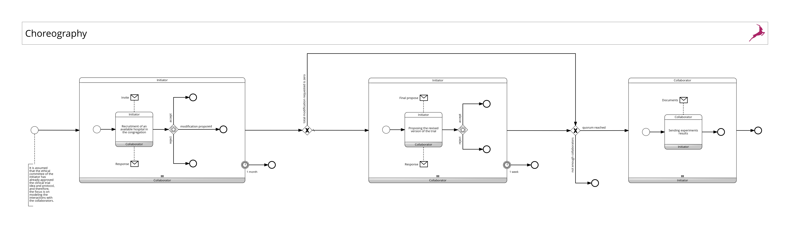
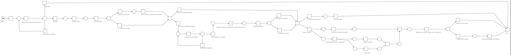
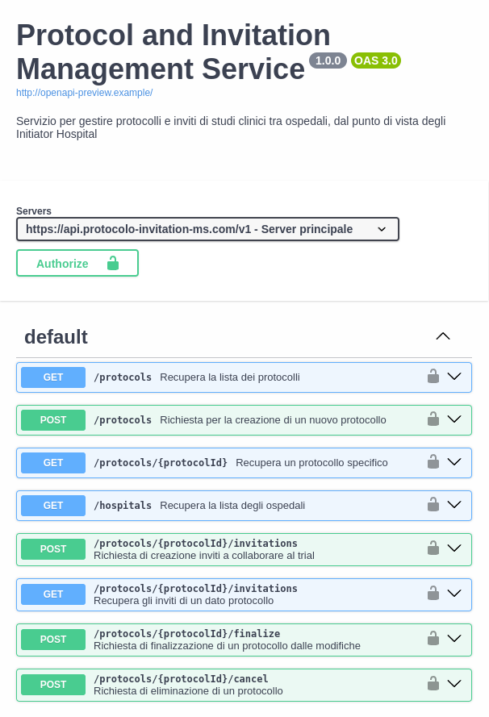
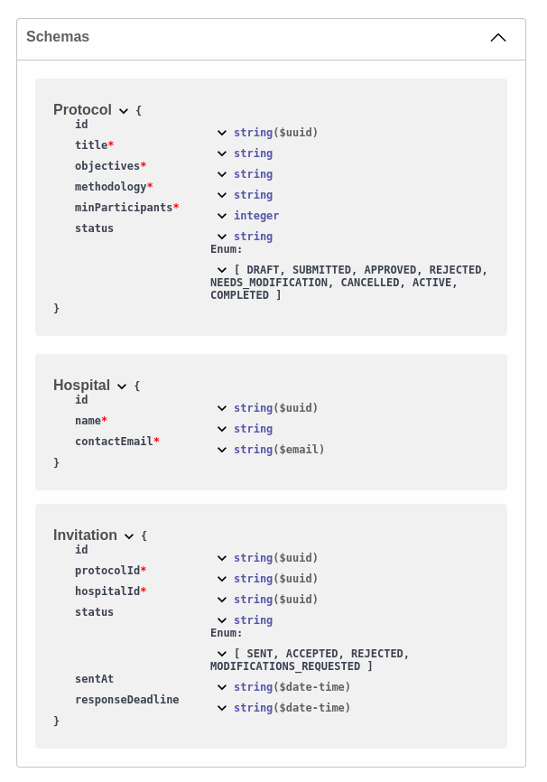
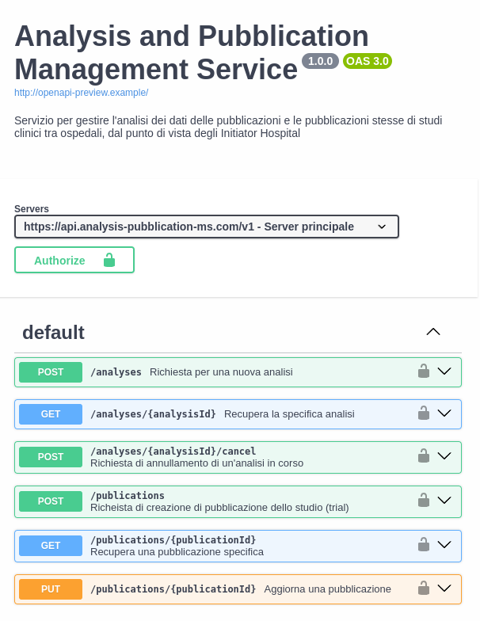
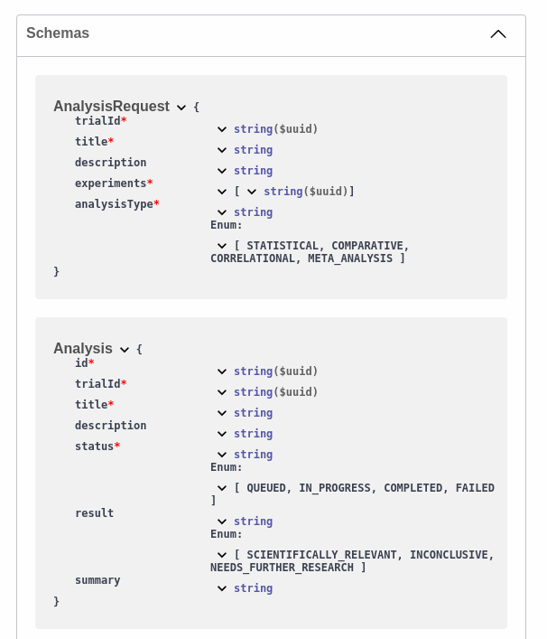
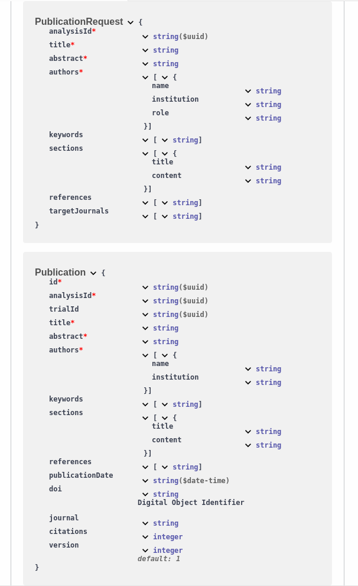

# TrialSync
This project aims to model the process of defining and managing a clinical trial, focusing on the roles of three main actors: the "Initiator" hospital, which proposes the research idea and sets the trial protocol; the "Collaborator" hospitals, which carry out the trial and collect data; and the "Ethical Committee," which is responsible for approving the protocol to ensure it meets ethical standards. As a group of two, we will consider a single Ethical Committee internal to the Initiator's hospital, streamlining the coordination and approval process for the clinical trial. 
This project, part of the Process Service Design course at POLIMI, aims to design an efficient and structured system to manage the interactions between these actors and ensure smooth trial execution.

## Members
- **<mark>Di Paola Gianluca (C.P. 10797584)</mark>**
- **<mark>Morelli Filippo (C.P. 10799749)</mark>**

# Milestone 1: Choreography, Collaboration, Petri net
The BPMN process we have structured involves the management of an experimental study in which two main actors are involved: the **Initiator Hospital (IH)** and the **Collaborator Hospital (CH)**, with the Initiator further divided into two departments: the **Clinical Research Department (CRD)** and the **Ethical Committee (EC)**.

### **Overall Process Structure**

1. **Phase 1 – Proposal and Evaluation**
    - The **CRD** defines the experimental protocol (objectives, methodology, minimum number of participants, etc.) and submits it to the **EC**.
    - The **EC** evaluates the proposal:
        - If the outcome is positive, the **CH** are invited to participate.
        - If the outcome is negative, the process ends.
        - If the **EC** requests modifications, the process returns to the beginning.
2. **Phase 2 – Invitation to Collaborators and Review**
    - The **CRD** sends an invitation to participate to all **CH** in the congregation that have the necessary resources.
    - The **CH** evaluate the proposal:
        - If they accept, they wait for the next phase.
        - If they decline, the process ends for them.
        - If they propose modifications, they send them to the **CRD**.
    - The **CRD** collects all modifications. If there are any, it revises the protocol (accepting the appropriate changes and discarding the unsuitable ones) and sends the new proposal to all **CH** who accepted or proposed changes.
    - The **CH** give their final response (acceptance or rejection).
    - If the minimum number of accepting **CH** is reached, the process moves to the next phase. Otherwise, the **Initiator** cancels the trial, and the process ends, notifying the **CH** about the trial cancellation.
3. **Phase 3 – Conducting the Experiment**
    - The **CRD** and the **CH** conduct the same experiment in parallel on patients, collecting data and preparing the final documentation.
    - During this phase, the **CH** send data to the **CRD**, which collects and processes it. The process remains on hold until all results from the **CH** are received.
4. **Phase 4 – Conclusions and Publication**
    - The **CRD** processes the data, performs statistical analysis, and decides on the outcome of the study:
        - If the study is scientifically relevant, the **CRD** prepares the final report and publishes it. The process ends for all.
        - If the study is inconclusive, the process ends for all.

### **Key Features of the Process**

- In Phase 2, the sending of invitations and managing the responses from the **CH** are treated as subprocesses, using timers to wait for responses and multi-instance mechanisms (to handle multiple **CH** simultaneously).
- In some phases, such as Phase 3, data is collected from multiple **CH** simultaneously, so the flow must remain parallel until all tasks are completed.

### **Important Assumptions**

- The **CH** are always able to recruit patients for the experiment.
- The **CH** do not participate in the final approval of the study, which depends solely on the **CRD**.

## Choreographed process [➔ PDF](/processes/PDF/Choreography.pdf)

## Collaboration Diagram [➔ PDF](/processes/PDF/Collaboration.pdf)

## Petri Net [➔ PDF](/processes/PDF/PetriNet.pdf)

> [!NOTE]
> Please note that <ins>the process is sound</ins>; indeed there are no deadlocks, livelocks or any other issues that could affect the soundness property.

# Milestone 2: Third party services 

We designed two REST services to support the Clinical Research Department (CRD) of the Initiator Hospital (IH) throughout the clinical trial lifecycle. They provide asynchronous interfaces that align with the clinical trial business process.
Characteristics:
- **RESTful interfaces**: Standard HTTP methods and status codes 
- **Asynchronous processing**: Long-running operations return immediate acknowledgments while processing continues in the background

## Protocol and Invitation Management [➔ OpenAPI](services/protocol-invitation/api-protocol-invitation.yaml), [➔ Server](services/protocol-invitation/src)

This service handles the early stages of clinical trials, allowing the CRD to define the experimental protocol and prepare the invites for the collaborating hospitals (CH). The CRD can create protocols with detailed specifications, browse available hospitals in the congregation, and prepare participation invitations. 

  
  

 

## Analysis and Pubblication Management [➔ OpenAPI](services/analysis-pubblication/api-analysis-pubblication.yaml), [➔ Server](services/analysis-pubblication/src)

Once experiments are conducted, this service is for the CRD to request in-depth data analysis from multiple experiments, determining if the success of the trial; it also transform the study's findings into scientific publication, facilitating the creation of formal publications with all necessary data.

  
  
  

 

# Milestone 3: Executable Process [➔ PDF](/implementation/docs/pdf_collaboration_executable.pdf)

The third milestone focuses on implementing the executable model of the interaction between the Initiator Hospital's Clinical Research Department (CRD) and the Collaborator Hospitals (CH). This executable process is modeled using **Camunda Modeler** and orchestrated by the **Camunda Engine** (specifically Zeebe). It leverages a combination of **RESTful service calls**, **user tasks with forms**, and **service tasks implemented via external workers** to manage the workflow from protocol definition and invitation to experiment execution and result analysis.

* **Protocol Management**
    * The CRD initiates the process by defining a new clinical trial protocol using a **User Task** linked to a specific form (`form_protocol_requirements`).
    * The "Define trial protocol" task then makes a **REST API call** (`POST` to `/v1/protocols`) to the Protocol and Invitation Management Service [(➔ OpenAPI)](services/protocol-invitation/api-protocol-invitation.yaml) to create the protocol.
    * The "Delete protocol" task also performs a **REST API call** (`DELETE` to `/v1/protocols/{protocolID}/cancel`) for protocol cancellation, interacting with the same service.

* **Invitation and Participation**
    * The "Prepare invites" task is a **Service Task** that executes a **REST API call** (`POST` to `/v1/protocols/{protocolID}/invitations`) to the Protocol and Invitation Management Service to generate invitations.
    * The actual sending of invitations and handling of cancellation notifications (e.g., "Trial cancelled" task) are implemented as **Service Tasks** handled by **Zeebe workers** defined in `clinical_trial_workers.js` (e.g., `Message_trial_cancelled` worker). These workers simulate interactions with external messaging systems.
    * The process utilizes `intermediate message events` for handling responses from Collaborator Hospitals and a `timer boundary event` (`timer_deadline`) for managing response deadlines.

* **Experiment Execution**
    * Tasks related to experiment execution of the CH (`phase_3_RETRIEVE`), are all implemented as **Service Tasks** executed by **Zeebe workers**. These workers, found in `clinical_trial_workers.js`, simulate the experimental phases including, leaving visible only the retrieval from the CRD perspective.

* **Data Analysis Request**
    * The CRD initiates the request for data analysis through the "Prepare analysis request" **User Task**, which is associated with a form (`form_analysis_request`).
    * A subsequent **Service Task** (inferred) would then trigger a **REST API call** to the Analysis and Publication Management Service (`POST` to `/v1/analyses`) to initiate the data analysis process.

* **Final Pubblication of the Paper**
    * If the clinical trial is found scientifically relevant from the analysis, the BP proceeds with the pubblication of the paper through the Analysis and Publication Management Service (`POST` to `/v1/publications`).
