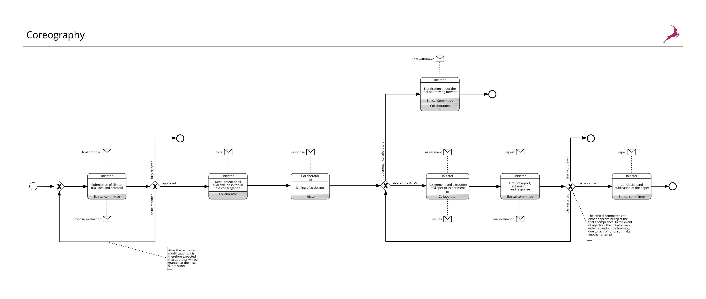
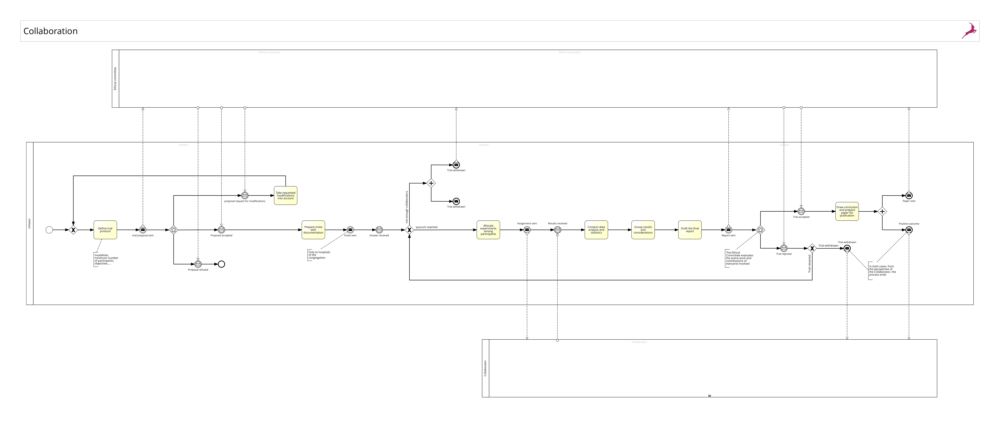

# TrialSync
This project aims to model the process of defining and managing a clinical trial, focusing on the roles of three main actors: the "Initiator" hospital, which proposes the research idea and sets the trial protocol; the "Collaborator" hospitals, which carry out the trial and collect data; and the "Ethical Committee," which is responsible for approving the protocol to ensure it meets ethical standards. As a group of two, we will consider a single Ethical Committee internal to the Initiator's hospital, streamlining the coordination and approval process for the clinical trial. This project, part of the PSD course at POLIMI, aims to design an efficient and structured system to manage the interactions between these actors and ensure smooth trial execution.

## Members:
- Di Paola Gianluca (C.P. 10797584)
- Morelli Filippo (C.P. XYZ)

## Choreographed process [➔ PDF](/milestone-1/Coreography.pdf)
TBA DESCRIPTION

## Collaboration Diagram [➔ PDF](/milestone-1/Collaboration.pdf)
TBA DESCRIPTION

## Petri Net
place here the image of the PetriNet corresponding to the executable model

# Third party services
- ...
## Executable process
place here an image of the BPMN diagram corresponding to the executable model of the process
