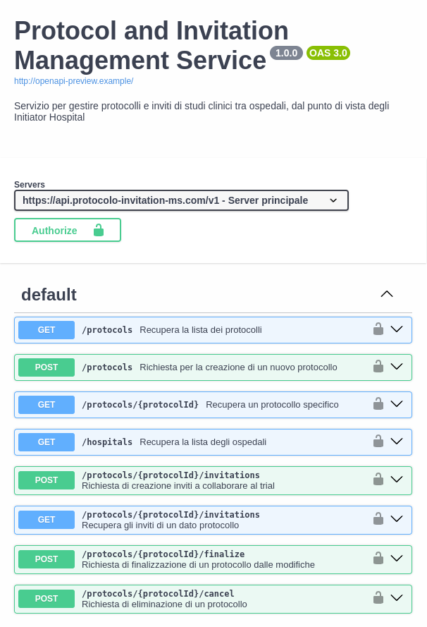
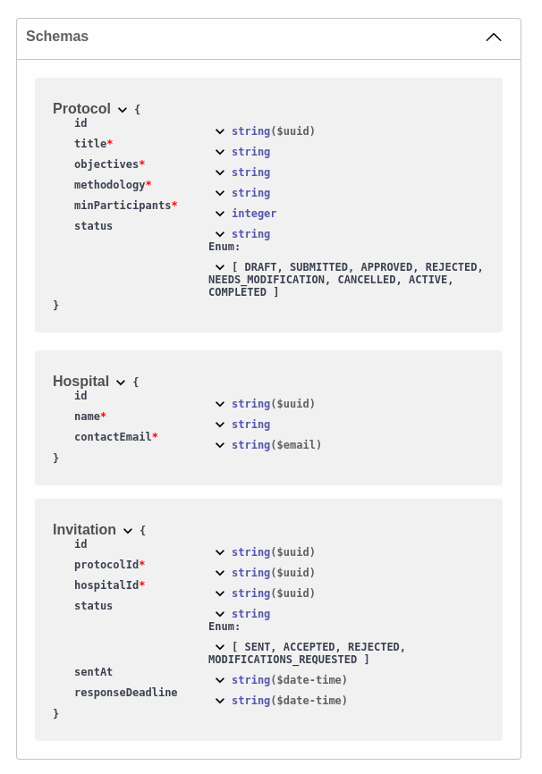
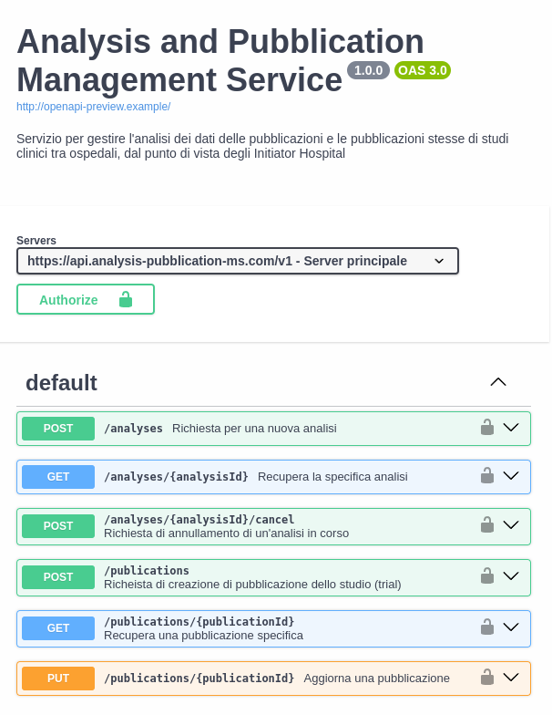
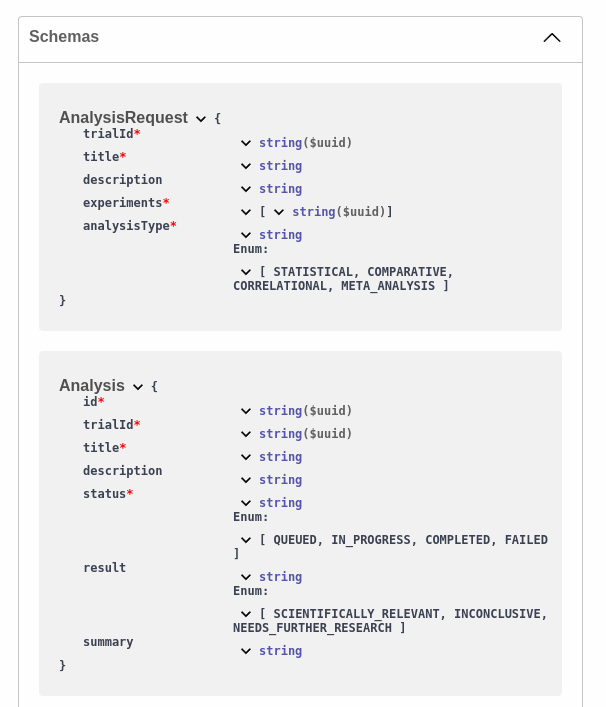
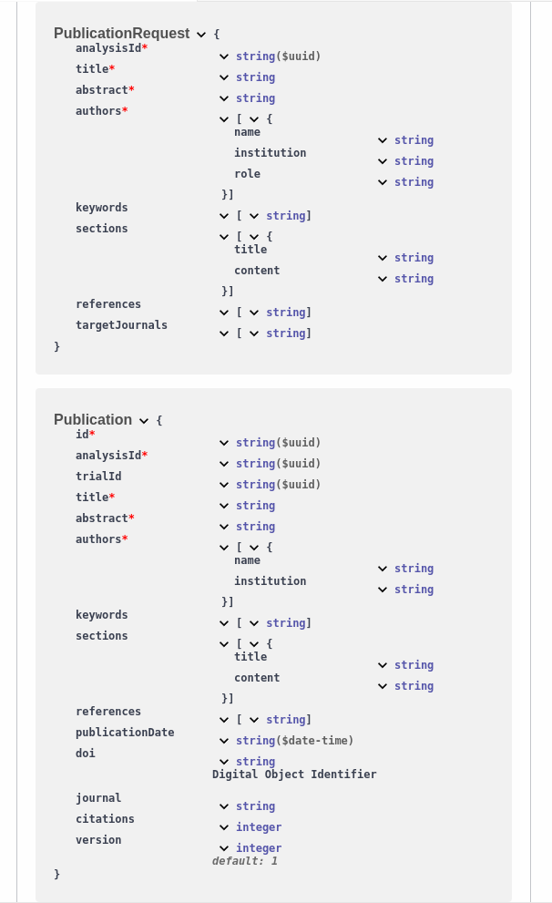

# Third-part Services

We designed two REST services to support the Clinical Research Department (CRD) of the Initiator Hospital (IH) throughout the clinical trial lifecycle. They provide asynchronous interfaces that align with the clinical trial business process.
Characteristics:
- **RESTful interfaces**: Standard HTTP methods and status codes 
- **Asynchronous processing**: Long-running operations return immediate acknowledgments while processing continues in the background

## Protocol and Invitation Management Service

This service handles the early stages of clinical trials, allowing the CRD to define the experimental protocol and prepare the invites for the collaborating hospitals (CH). The CRD can create protocols with detailed specifications, browse available hospitals in the consortium, and prepare participation invitations. 

  
  

 

## Analysis and Publication Management Service

Once experiments are conducted, this service is for the CRD to request in-depth data analysis from multiple experiments, determining if the success of the trial; it also transform the study's findings into scientific publication, facilitating the creation of formal publications with all necessary data.

  
  
  

 
